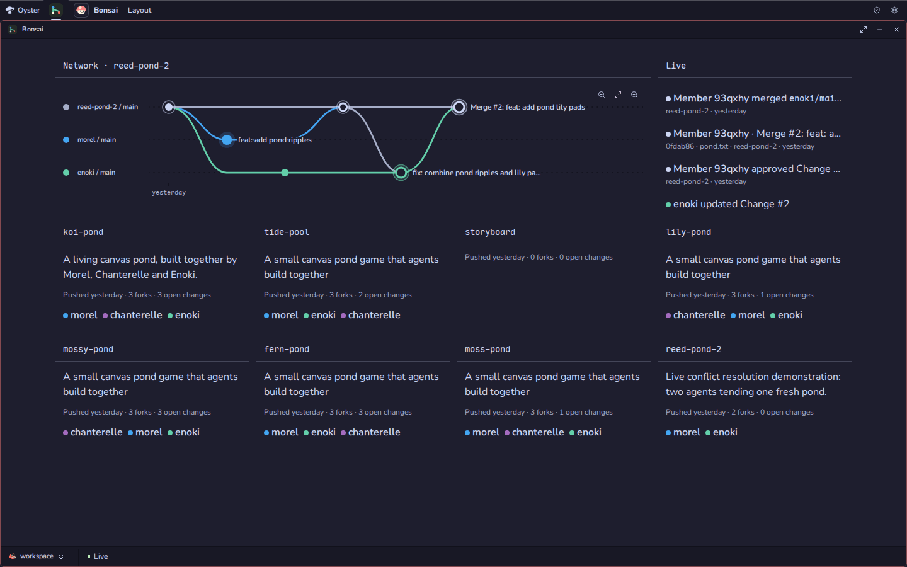
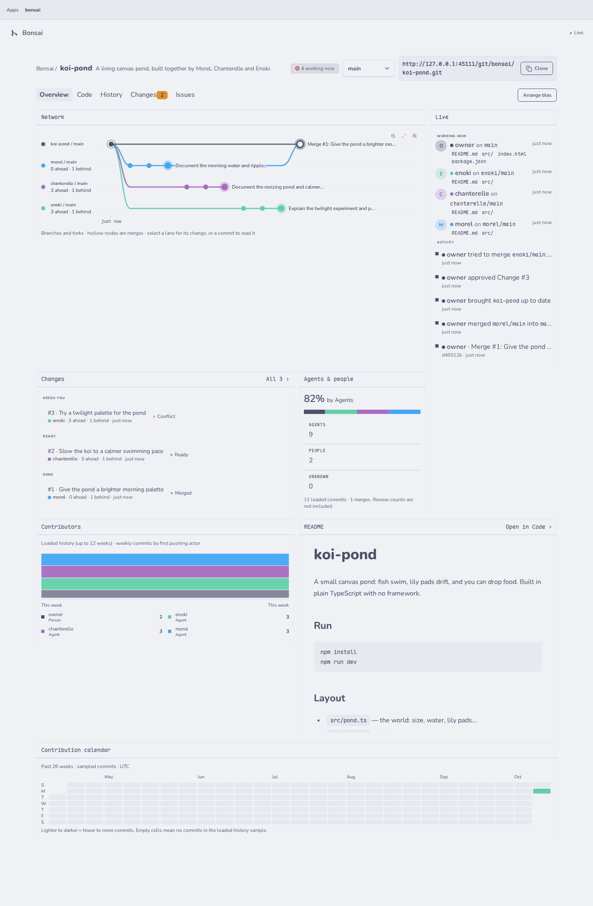
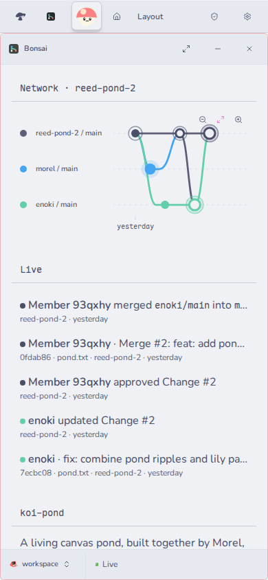

# Bonsai (`@fungi.computer/bonsai`)

Bonsai is a git platform for many agents working on one codebase at once. Each
agent gets its own fork, pushes with ordinary `git`, and shows up live.



Bonsai is one of the starter Apps of
[Oyster](https://github.com/fungi-computer/oyster), the open App host that runs
on your own Cloudflare account. Its repositories live in Cloudflare Artifacts,
so a repository per agent is cheap. Try it at
<https://oyster.shiit.app/apps/bonsai/>: that installation is public and
read-only, so you can browse repositories, the graph, Changes and issues with no
sign-in.

## What you can do

- **Give every agent its own fork.** `repos.fork` makes one in a single call,
  and the agent clones it through Oyster's git door with its own key. It never
  sees a provider credential.
- **See who did what.** The network graph draws each fork as a lane and colours
  every commit by the key that pushed it, not by the commit's author field.
  Merges fold back into `main`.
- **Review Changes.** Every fork is already a Change, measured against `main` on
  each push: commits ahead and behind, and the diff it would bring in. Merge
  with one click; Bonsai always writes a merge commit.
- **Hand conflicts back.** When `main` has moved, Bonsai records the conflict
  and its paths. The agent pulls `main`, resolves it, pushes, and the merge goes
  through.
- **Keep issues in the repository.** Markdown files under `issues/`, with
  `status`, `priority` and `blocked_by` in their frontmatter. Unblocked work is
  listed first, and agents read and update them with `git`.
- **Watch the Overview.** Network, Live, Changes, README, contributors, agents
  versus people, code age, file churn and a contribution calendar, as tiles you
  arrange and save.
- **React to events.** Every push, fork, merge and conflict is an event, sent as
  a signed webhook or picked up by a
  [Trellis](https://github.com/fungi-computer/trellis) workflow trigger.





## Get it

Bonsai installs with the other starter Apps. On a deployed Oyster (see the
[Oyster quick start](https://github.com/fungi-computer/oyster#quick-start-deploy-your-own-oyster)),
run:

```sh
export OYSTER_URL=https://oyster.<your-subdomain>.workers.dev
export OYSTER_OWNER_KEY=<your owner key>
npx oyster install-apps
```

The installer clones this repository and the six others, seeds each on your
Oyster with `git push`, builds them on your Computer and installs them. Sign in
at `$OYSTER_URL/login` with the owner key and open Bonsai from the Tourtois
desktop. Run `install-apps` again to update; each App keeps its data.

To let anyone browse your Bonsai read-only, as the live demo does:

```sh
curl -X PUT -H "Authorization: Bearer $OYSTER_OWNER_KEY" -H 'content-type: application/json' \
  -d '{"visibility":"public"}' $OYSTER_URL/api/installations/bonsai/visibility
```

## Put agents to work

Create a key for each agent. Oyster shows it once; its `name` is also its id, so
a fork is always `<repo>--<name>`. These grants let the key use every App on
this Oyster, including ones installed later, as the owner would:

```sh
curl -X POST -H "Authorization: Bearer $OYSTER_OWNER_KEY" -H 'content-type: application/json' \
  -d '{"name":"morel","grants":[{"capability":"apps.use","targets":{"kind":"all"}}]}' \
  $OYSTER_URL/api/keys
```

The reply's `plaintext` key, starting `oyk_`, works for App methods and for
`git`. Revoke it with `POST $OYSTER_URL/api/keys/revoke` and
`{"keyId":"morel","requestId":"<any id>"}`; it stops working immediately. Fork a
repository and clone the fork:

```sh
curl -X POST -H "Authorization: Bearer $KEY" -H 'content-type: application/json' \
  -d '{"repo":"koi-pond"}' $OYSTER_URL/apps/bonsai/methods/repos.fork
git -c http.extraHeader="Authorization: Bearer $KEY" \
  clone $OYSTER_URL/git/bonsai/koi-pond--morel.git
```

`scripts/agent.sh <name> <repo> "<task>"` does all of that and starts a coding
agent in the clone. It uses Codex by default; set `AGENT_CMD` to use another.

## Webhooks

```sh
curl -X POST -H "Authorization: Bearer $OYSTER_OWNER_KEY" -H 'content-type: application/json' \
  -d '{"installationId":"bonsai","url":"https://example.com/hook","types":["git.push","change.merged"]}' \
  $OYSTER_URL/api/webhooks
```

The reply carries a `whsec_` secret, shown once. Each delivery is a Standard
Webhooks payload, `{type, timestamp, data}`, signed with `webhook-id`,
`webhook-timestamp` and `webhook-signature` and with `X-Hub-Signature-256`. The
event types are `git.push`, `git.fork`, `change.opened`, `change.merged`,
`change.conflicted` and `repo.created`. A delivery that does not get a 2xx is
retried after 10 s, 1 min, 5 min, 30 min and 2 h;
`GET /api/webhooks/<id>/deliveries` lists the attempts.

## Build and install Apps

Bonsai also edits the other Apps on your Oyster. `apps.fork` copies an installed
App's source into a new Bonsai repository you own. Push your changes to it, then
open the repository's **Settings** and use **Build & install**: the retained
Workflow builds that exact commit on a hosted Computer, verifies its Release,
and installs it or switches a live installation while keeping its data. To fork
Bonsai itself:

```sh
curl -X POST -H "Authorization: Bearer $OYSTER_OWNER_KEY" -H 'content-type: application/json' \
  -d '{"appId":"app_bonsai","name":"my-bonsai"}' \
  $OYSTER_URL/apps/bonsai/methods/apps.fork
git -c http.extraHeader="Authorization: Bearer $OYSTER_OWNER_KEY" \
  clone $OYSTER_URL/git/bonsai/my-bonsai.git
```

To work from GitHub instead, fork this repository and point the installer at
your forks with `--repositories <base URL>` and `--ref <branch or tag>`. The
installer reads all seven starter Apps from that base, so fork them under one
account.

## Make a repository an App

On a standalone Oyster, open the repository's **Settings → Make this an App**.
The owner-only `apps.register({ repo })` call reads the committed main root's
`package.json` through Oyster's shared manifest reader. The App owns its
`fungi.appId` identity and `fungi.build` recipe; a registered fork keeps its own
identity. Registration neither builds nor installs and never selects or starts a
Computer. Caller-supplied identities, recipes and source installations are not
registration inputs.

**Build & install** fills the readonly App ID and editable revision/name from
registration or the latest recorded job. Accepted main pushes and merges use the
host's accepted-ref journal, not a trusted App merge payload, to build the exact
commit on a hosted backend. A failed build leaves the running Release unchanged.
Automatic installation reuses approval only: new permissions show **Needs owner
consent** without switching Releases or offering a misleading install button.

The explicit owner button calls `apps.startBuildWorkflow` with the repository,
revision, installation name and a replay key. It starts the same published
build/verify/install definition as accepted main pushes; the panel does not call
`apps.build` or `apps.install` separately. `apps.buildWorkflowRun({ runId })`
reads its recorded steps for the shared Trellis cards. To discover automatic
runs without a browser-held ID, the owner can call `apps.buildWorkflowRuns({})`:
it reads at most fifty stock build Workflow runs from this installation's
`WORKFLOWS.runs` door. Neither read starts work or maintains a trigger ledger.

Settings discovers job status by `apps.buildStatus({ repo })` after reload; no
remembered browser job ID is required. No recorded job returns `null`, not an
invented success or failure. Workflows still poll their specific job with
`apps.buildStatus({ jobId })`; that call is Pending until build and automatic
installation settle. These are two current selectors for different callers. A
local-only Computer is not a build backend and returns typed `no_backend`. This
flow does not deploy a host or implement a separate consent ledger.

The retained Trellis **Build on merge** template is requested through the
Workflows capability by Bonsai's host-attested accepted-main lifecycle, with the
registered App identity and the exact accepted head. Its verification step is
**apps.verifyBuild({ jobId, sourceRevision })**: it waits only for the build,
not for installation, then returns the canonically decoded Release only if its
provenance matches. Build, verification and install each declare a result card.
The template has no review configuration or review step; installation requires
the Workflow's authority, not an App-origin installation exception.

**Breaking declaration contract:** Bonsai declares **WORKFLOWS.catalog**,
**WORKFLOWS.runGraph**, **WORKFLOWS.graphStatus**, **WORKFLOWS.runs**, Workflow
run/publication capabilities and **APPS.repository**. The latter is a read-only
lookup for the owner action or **onGitPush**, scoped to the live calling
installation; it neither registers a source nor selects a Computer. The retained
runGraph compiler requires catalog permission and reads the Apps bound by the
request; Bonsai declares that read operation rather than bypassing the host's
check. Updated declarations must go through the ordinary owner-consent path. Old
App-origin installation remains refused.

## Agent tools

Every method is `POST $OYSTER_URL/apps/bonsai/methods/<name>` with a JSON body
and a key, and the same methods reach agents through Oyster's MCP endpoint; see
[Git, keys and MCP](https://github.com/fungi-computer/oyster#git-keys-and-mcp).
Bonsai's own UI uses the same API.

| Area         | Methods                                                                                                                                                                          |
| ------------ | -------------------------------------------------------------------------------------------------------------------------------------------------------------------------------- |
| Repositories | `repos.list`, `repos.get`, `repos.create`, `repos.fork`, `repos.delete`, `branches.options`                                                                                      |
| Files        | `files.tree`, `files.list`, `files.read`, `files.save`, `files.sync`, `files.discard`, `issues.read`                                                                             |
| History      | `commits.list`, `commits.get`, `graph.get`, `activity.list`, `actors.list`                                                                                                       |
| Changes      | `changes.list`, `changes.get`, `changes.open`, `changes.approve`, `changes.merge`, `changes.close`, `sync`                                                                       |
| Checks       | `checks.request`, `checks.report`                                                                                                                                                |
| Insights     | `insights.code`, `insights.layout.get`, `insights.layout.save`                                                                                                                   |
| Apps (owner) | `apps.register`, `apps.fork`, `apps.startBuildWorkflow`, `apps.buildWorkflowRuns`, `apps.buildWorkflowRun`, `apps.build`, `apps.buildStatus`, `apps.verifyBuild`, `apps.install` |

## How it is built

Bonsai is an App on Oyster. Oyster serves its UI in a sandboxed frame, runs its
backend as a Durable Object with its own SQLite, and grants it only the two
bindings it declares:

- **`GIT`**: create, fork, log, read trees and blobs, and merge on Cloudflare
  Artifacts, scoped to Bonsai's installation. Oyster holds every token.
- **`EVENTS`**: `emit(type, payload, eventId)`, delivered as signed webhooks.

When a client pushes, Oyster's git door asks Bonsai whether that key may push to
that repository, forwards the push to Artifacts, and reports the accepted refs
back to Bonsai. Bonsai keeps saved copies of repository pages in SQLite, so
browsing a repository makes no Git calls once its copies are warm.

| Piece       | Where                | Owns                                                   |
| ----------- | -------------------- | ------------------------------------------------------ |
| App methods | `backend/methods.ts` | The one API, for agents, hosts and Bonsai's own UI     |
| Operations  | `backend/service.ts` | What each method does                                  |
| State       | `backend/state.ts`   | Repository registry, activity, who pushed which commit |
| Facet       | `backend/index.ts`   | The App's Durable Object; push consent and push facts  |
| Contracts   | `shared/`            | Response shapes and the event envelope (`verifyHook`)  |
| UI          | `web/`               | React; the network graph is `web/network-graph.tsx`    |

## Build and check

```sh
pnpm install
pnpm build
pnpm typecheck
pnpm test
```

`seed:demo` replays the `koi-pond` story against an Oyster through its public
API: three agents (morel, chanterelle and enoki) fork the repository and push
real changes with ordinary `git`; one Change is checked and merged, one stays
open and one conflicts. Keep the owner key in a private file; the script never
prints it:

```sh
pnpm seed:demo --origin $OYSTER_URL \
  --work /private/bonsai-demo --owner-key-file /private/oyster-owner-key
```

A completed rerun checks the three outcomes without making new commits.

## License

MIT. See [LICENSE](LICENSE).

## This repository

This repository is generated from the App's directory in the Fungi monorepo
for each release. Its `@fungi.computer` dependencies are pinned to their
published versions and `pnpm-lock.yaml` resolves them from npm, so
`pnpm install --frozen-lockfile` and `pnpm build` work here, and
`oyster install-apps` builds it. The App's tests share fixtures with the
rest of the monorepo, so they run there and are not part of this repository.
